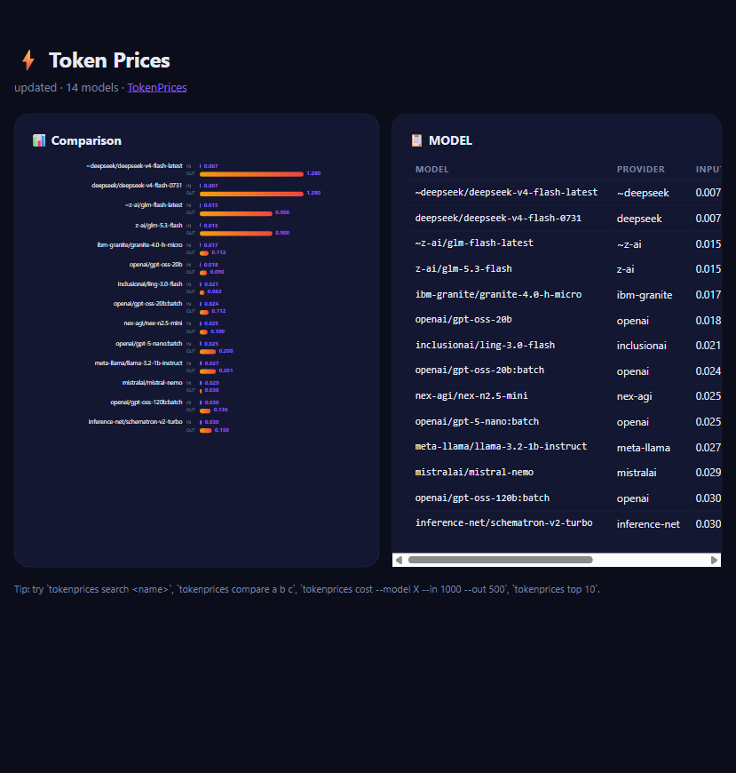
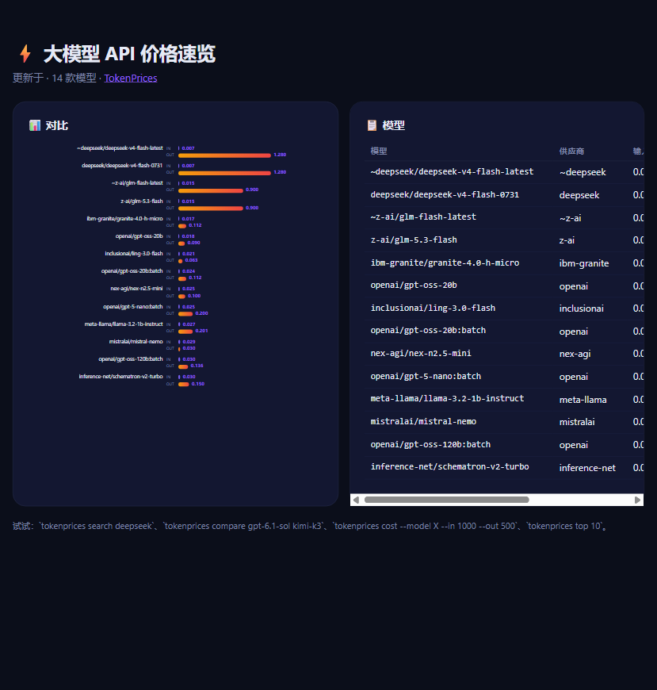

# ⚡ TokenPrices — the LLM API price board for your terminal

**One command shows the live per-million-token price of 465+ LLM models** (OpenAI, Anthropic, Google, DeepSeek, xAI, Meta, Alibaba, ByteDance, Moonshot, Step …), finds the cheapest model for your workload, compares models side by side, computes how much a prompt will cost, **watches models for API price drops**, and renders a share-ready HTML price chart. EN / 中文.

In 2026 every week brings a new price cut (GPT-6.1 Sol at $2/$10, DeepSeek V4-Flash at $0.09/M, Gemini 3.8 Flash promo, Step 5 Preview open-sourced…). Stop comparing pricing pages by hand:

```bash
$ tokenprices                                # live price board
$ tokenprices search deepseek                # filter by name / provider
$ tokenprices compare gpt-6.1-sol kimi-k3    # side-by-side + cheapest hint
$ tokenprices cost gpt-6.1-sol --in 1000 --out 500   # how much does a call cost
$ tokenprices watch kimi-k3                  # watch for API price drops
$ tokenprices top 10 --free                  # cheapest / free models
$ tokenprices --html report.html             # share-ready dark price chart
```

## ✨ Highlights

| | |
|---|---|
| ⚡ **Zero setup** | pure-Python CLI, standard library only — no `requests`, no `pandas`, no API key |
| 🗄 **Three data sources** | live OpenRouter API (465+ models), LiteLLM pricing DB (4,000+ entries), and a built-in **domestic reference table** (DeepSeek / Zhipu GLM / Moonshot Kimi + current OpenAI & Google list prices, each row with its source link & date) |
| 🪙 **Real prices** | values come straight from the providers' own price feeds, in USD per 1M tokens — compare OpenRouter vs direct-official prices for the same model |
| 🧮 **Cost calculator** | `cost --model X --in N --out N [--calls N]` — know the bill before you send a single request |
| 🔔 **Price-drop watch** | `watch <model>` monitors the live price, keeps a baseline in `~/.tokenprices/watch.json` and alerts you the moment it drops below the previous minimum (threshold via `--drop`) |
| 📊 **Share-ready HTML report** | dark, zero-CDN SVG chart (input & output bars) + full table, opens in your browser automatically |
| 🌐 **EN / 中文** | full bilingual output, terminal and report |
| 🔌 **Script-friendly** | `--json` export, `--refresh` / `--offline` (12h cache), clean exit codes |

## 📸 Report preview

| English | 中文 |
|---|---|
|  |  |

## 🚀 Install

Requires **Python 3.8+**.

```bash
# Option A — one file, no install
curl -O https://raw.githubusercontent.com/Koiliblly/TokenPrices/main/tokenprices.py
python tokenprices.py --help

# Option B — pip
pip install tokenprices
tokenprices --help
```

## 🕹 Usage

### Price board & search

```bash
tokenprices                         # first 20 models (by input price)
tokenprices list --limit 50
tokenprices search deepseek         # matches model id or provider
tokenprices search gemini --lang zh
tokenprices search --free           # only free models
tokenprices search --source litellm gpt   # switch data source
```

### Compare & cost

```bash
tokenprices compare gpt-6.1-sol kimi-k3 gemini-3.8-flash
tokenprices compare step-5-preview deepseek-v4-flash

tokenprices cost gpt-6.1-sol --in 1000 --out 500          # one call
tokenprices cost kimi-k3 --in 8000 --out 4000 --calls 100 # batch
```

Fuzzy matching is built in: `kimi-k3` resolves to `moonshotai/kimi-k3`, so you don't need to remember exact ids.

### Cheapest & free

```bash
tokenprices top 10          # cheapest models by input price
tokenprices search --free   # free-tier models for experiments
```

### Reports & export

```bash
tokenprices --html report.html              # opens a share-ready dark chart
tokenprices --json models.json --limit 100  # machine-readable export
tokenprices --offline                       # use the 12h cache only
tokenprices --refresh                       # force refetch
```

### 🔔 Price-drop watch

Watch one or more models and get alerted the moment their API price drops. The first check records a baseline; afterwards any check that finds a price below the previous minimum fires an alert. History lives in `~/.tokenprices/watch.json`.

```bash
tokenprices watch kimi-k3                   # loop mode: check every hour, Ctrl+C to stop
tokenprices watch kimi-k3 --interval 1800   # check every 30 minutes
tokenprices watch gpt-6.1-sol --drop 10     # only alert on drops of >= 10%
tokenprices watch kimi-k3 --once            # single check (cron-friendly)
tokenprices watch --list                    # show all watched models
tokenprices watch --remove kimi-k3          # stop watching
```

Cron / systemd users can run `--once` on a schedule — the baseline and minimum are persisted, so a scheduled check still fires alerts:

```bash
# every day at 09:00
0 9 * * *  tokenprices watch kimi-k3 --once >> ~/.tokenprices/watch.log 2>&1
```

An alert looks like this:

```
🔔 PRICE DROP moonshotai/kimi-k3 · OUTPUT $11.94 → $9.55  (-20.0%)
```

## 🗄 Data sources

| Source | What it gives | Key needed |
|---|---|---|
| [OpenRouter models API](https://openrouter.ai/docs/guides/overview/models) | 465+ models, live per-token USD pricing, context lengths | no |
| [LiteLLM pricing DB](https://raw.githubusercontent.com/BerriAI/litellm/main/model_prices_and_context_window.json) | 4,000+ entries across 30+ providers | no |
| Built-in **domestic table** | direct official reference prices (CNY → USD at ~7.1) for DeepSeek, Zhipu GLM, Moonshot Kimi, plus current OpenAI / Google flagship list prices — every row carries its source URL and date | no |

Prices on OpenRouter are billed at the provider's list price (plus a small credit fee), while direct-official prices (DeepSeek, GLM, Kimi …) are often cheaper — `--source domestic` shows those. All values are **USD per 1M tokens**; zero means the model is free.

## 🔐 Privacy

- Everything runs locally on your machine. No accounts, no servers, no analytics, no tracking.
- The tool only ever reads public price feeds; it never sends your prompts, files, or API keys anywhere.
- Cached data lives in `~/.tokenprices/` (12-hour TTL) and can be deleted any time.

## 🛠 Tech

- Single `tokenprices.py`, **Python standard library only** — zero dependencies.
- Hand-rolled SVG chart in the HTML report — zero CDN, works offline.
- 12-hour disk cache, `--refresh` / `--offline` control.
- Bilingual i18n table, CJK-aware column alignment.

## 📄 License

MIT © 2026 Koiliblly — see [LICENSE](LICENSE).
